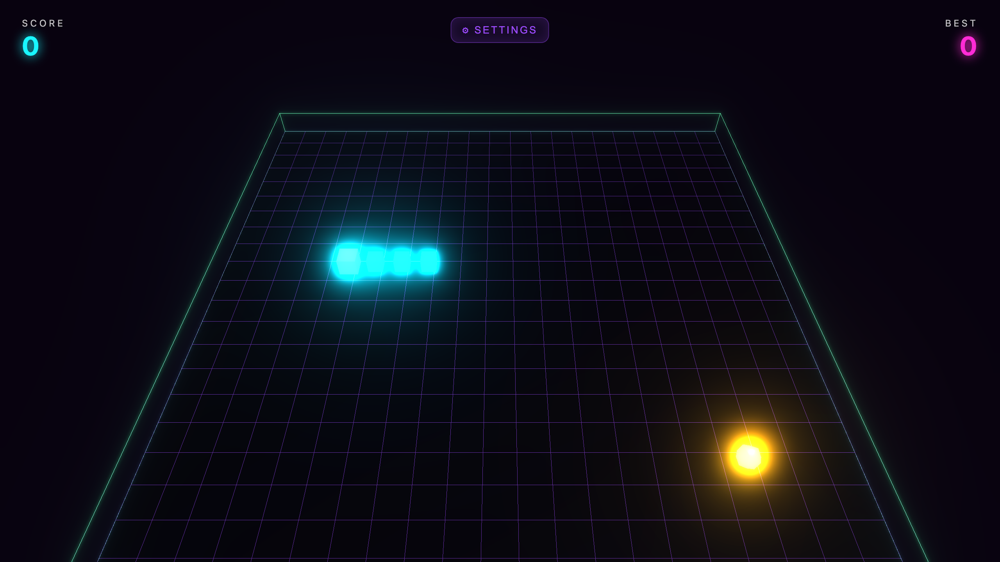

<h1 align="center">🐍 Neon Snake 3D</h1>

<p align="center">
  A synthwave take on Snake — rendered in 3D with Three.js, driven by a
  <strong>pure, deterministic, fully-tested game core</strong>.
</p>

<p align="center">
  <a href="https://github.com/samuel-cabral/snake-3d/actions/workflows/ci.yml">
    
  </a>
  
  
  
  
</p>

<p align="center">
  
</p>

<p align="center"><strong>▶ Play it: https://samuel-cabral.github.io/snake-3d/</strong></p>

---

## Why this repo is interesting

It's a small game, engineered like production software. The point isn't the
gameplay — it's the **separation of concerns** that makes that gameplay
trivially testable and easy to evolve:

- **A pure, headless game core** (`src/core`) with zero browser or Three.js
  dependencies. The entire simulation is `reduce(state, action) -> state`, so
  every rule — movement, collision, growth, food spawning, the shrinking
  arena, the win condition — is unit-tested in milliseconds. **~99% coverage,
  enforced in CI.**
- **A seedable RNG threaded through immutable state**, making food placement
  reproducible: tests assert exact spawns; the same seed replays identically.
- **A fixed-timestep loop with render interpolation** — deterministic
  simulation decoupled from frame rate, smooth motion between ticks.
- **Adapter layers** for rendering, input, audio, UI and storage, each
  depending on the core but never the other way around.
- **A real toolchain:** TypeScript (strict, `noUncheckedIndexedAccess`),
  Vitest with coverage gates, Playwright E2E, ESLint + Prettier, a Husky
  pre-commit hook, and a GitHub Actions pipeline that ships to GitHub Pages.

See [`docs/ARCHITECTURE.md`](docs/ARCHITECTURE.md) for the full picture and
[`docs/adr/`](docs/adr) for the decisions behind it.

## Gameplay

| Action          | Keys                                           |
| --------------- | ---------------------------------------------- |
| Move            | Arrow keys / `W` `A` `S` `D` / on-screen d-pad |
| Start / restart | `Space` / `Enter` / tap                        |
| Pause           | `P` / `Esc`                                    |

- **Shrinking arena** — every few foods the neon walls close in, raising the
  pressure.
- **Difficulty presets** — Easy / Normal / Hard tune speed and how fast the
  arena tightens.
- **Synthesized audio** — eat/crash effects via the Web Audio API, no assets.
- **Persistent best score and settings** via `localStorage`.

## Architecture at a glance

```
            input ─┐
                   ▼
   ui  ◀──  app (composition root)  ──▶  rendering (Three.js)
                   │   ▲
            audio ─┘   │ reads state
                       ▼
                 core (pure)   ◀── platform (storage)
        reduce(state, action) -> state   ·   seedable RNG
```

The dependency rule is one-directional: **`core` knows nothing about the
browser**; everything else depends on `core`.

## Tech stack

TypeScript · Three.js · Vite · Vitest · Playwright · ESLint · Prettier ·
Husky · GitHub Actions

## Getting started

Requires **Node 22+** and **pnpm**.

```sh
pnpm install
pnpm dev          # http://localhost:5173
```

### Scripts

| Command                     | What it does                   |
| --------------------------- | ------------------------------ |
| `pnpm dev`                  | Start the Vite dev server      |
| `pnpm build`                | Typecheck and build to `dist/` |
| `pnpm preview`              | Serve the production build     |
| `pnpm test`                 | Run unit tests                 |
| `pnpm test:coverage`        | Unit tests with coverage gates |
| `pnpm e2e`                  | Playwright end-to-end tests    |
| `pnpm lint` / `pnpm format` | Lint / format                  |

## Project structure

```
src/
  core/        pure simulation — types, rng, systems, reducer, state machine
  rendering/   Three.js adapter — scene, board, snake, food, bloom
  input/       keyboard + touch -> semantic control events
  audio/       Web Audio sound effects
  ui/          HUD, overlays, settings (DOM)
  platform/    localStorage adapter
  app/         composition root + game loop
tests/
  unit/        Vitest — the whole core (+ storage)
  e2e/         Playwright — full play-flow smoke
docs/          architecture + ADRs
```

## License

[MIT](LICENSE) © Samuel Cabral Lima
